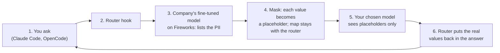
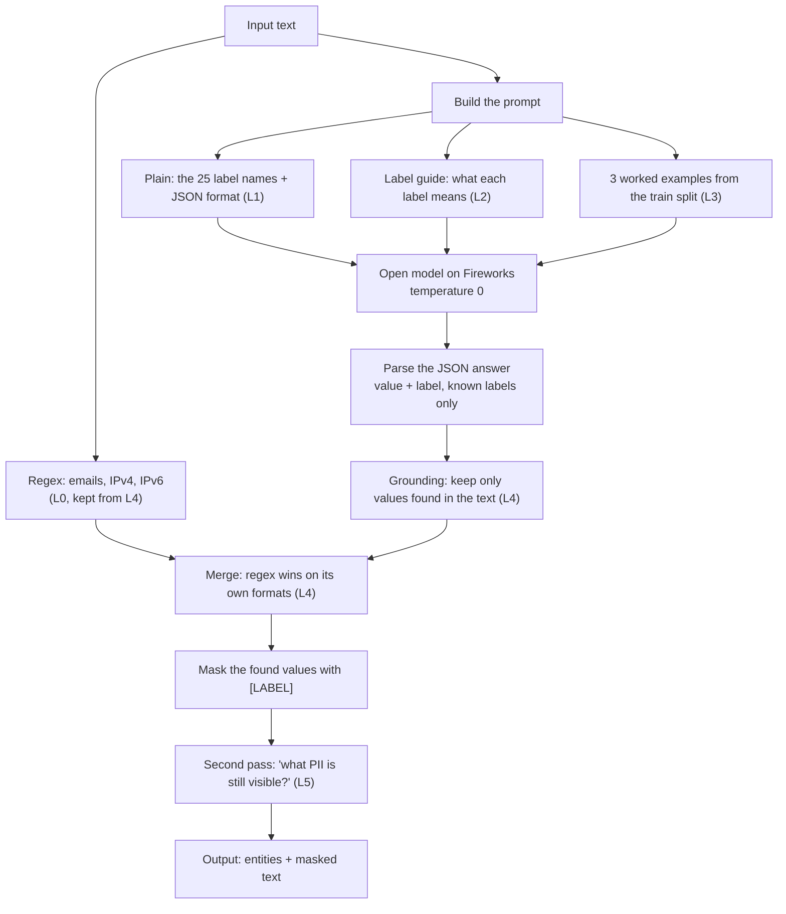

# PII redaction with a fine-tuned open model on Fireworks

We built a model that finds personal data (PII) in text before the text is sent to an outside AI model. We started from rules, then a plain prompt on GLM 5.3 Flash, then a layered prompt harness, then a LoRA fine-tune. Every step was scored on the same 500 locked test texts.

**Headline:** the best prompt harness raises typed F1 from 84.5% to 88.1%. The LoRA fine-tune of GLM 5.3 Flash, with the same plain prompt, reaches **92.7% typed F1** (+8.2 over the plain prompt, +4.6 over the best harness). Wrapped in the full harness it removes 99.0% of personal values and leaves 94.8% of texts with no leak.


Deck: https://claude.ai/artifact/7xvUxa8vTG42FAfF3fEtiw

**Disclosure.** The offline anonymizer in `scripts/anonymize.py` existed before the event; it was built for Brazilian legal documents and copied into this repo on the day from earlier private work. Everything else here was built on the day. We used AI coding assistants (Claude Code, Cursor) throughout.

## Contents

**Part 1: Submission**
1. [The task](#1-the-task)
2. [Test set and scoring](#2-test-set-and-scoring)
3. [Baseline and prompt harness](#3-baseline-and-prompt-harness)
4. [Fine-tune](#4-fine-tune)
5. [Results](#5-results)
6. [Is it real?](#6-is-it-real)
7. [Self-assessment against the rubric](#7-self-assessment-against-the-rubric)
8. [Limitations](#8-limitations)
9. [Next](#9-next)

**Part 2: Reproduce**

10. [Setup](#10-setup)
11. [Prompt harness runs](#11-prompt-harness-runs)
12. [Fine-tune and value-only scoring](#12-fine-tune-and-value-only-scoring)
13. [Router demo](#13-router-demo)
14. [Multi-provider evaluation](#14-multi-provider-evaluation)
15. [Tests](#15-tests)
16. [Where every number comes from](#16-where-every-number-comes-from)
17. [Data, license and sources](#17-data-license-and-sources)

---

# Part 1: Submission

## 1. The task

Teams want to send support tickets, emails and legal files to an LLM without sending the personal data in them. That means finding every personal value, naming its type, and masking it before the text reaches an outside AI model.

| | |
|---|---|
| The job | Find every personal value in a text and label it with one of 25 types (name, email, passport, street…) |
| Who needs it | Legal, security and compliance teams that route client text through AI models |
| Why rules are not enough | Regex finds 9.8% of personal values; names, addresses and ID numbers have no fixed format |
| Why not a frontier API | The outside provider receives the personal data; with the router, raw text goes only to the company's own Fireworks deployment |
| Why a fine-tuned open model | More accurate, faster, and the company owns the weights |
| The data | ai4privacy/pii-masking-300k, English, synthetic but labeled per value |

How it runs: a router in Claude Code or OpenCode sends the text first to the company's fine-tuned model on Fireworks. The router replaces each value with a placeholder, sends only the masked text to the model the user chose, and puts the real values back in the answer.



`scripts/router_demo.py` runs this path on one email: the fine-tune found all 8 values, Kimi K3 drafted a reply seeing only placeholders, and the router restored the real values (`runs/router_demo.txt`). It is one example, not a measurement. Today we measured step 3.

## 2. Test set and scoring

- 500 English texts from the validation split, with 3,309 personal values. 51 texts contain none, so over-redaction is measured. Locked with a SHA-256 hash (`data/test_set.sha256`) before any model ran.
- Training rows come only from the train split.
- **Typed F1** (headline): the value must be exact and the label right.
- **Leak recall** (privacy): the share of personal values removed from the masked text, whatever label they got. A wrong label is harmless if the value is masked.
- Failed API calls count against the system. Every system: same 500 texts, temperature 0, one saved row per text.

## 3. Baseline and prompt harness

Each layer keeps the one before it and adds one change.

| Layer | Change | Typed F1 | Leak recall | Seconds per text |
|---|---|---|---|---|
| L0 | Rules only (regex) | 17.7% | 9.8% | 0.0 |
| L1 | Plain prompt, GLM 5.3 Flash | 84.5% | 98.8% | 4.0 |
| L2 | + label guide | 86.5% | 97.9% | 5.5 |
| L3 | + 3 worked examples | 87.7% | 98.4% | 2.8 |
| L4 | + grounding and regex | 87.8% | 98.6% | 3.1 |
| L5 | + second pass on the masked text | 88.1% | 99.0% | 3.8 |


The label guide and the examples are real gains (both statistical tests agree); grounding and the second pass are too small to separate from luck. A larger model (qwen3p8-max) with the L4 setup scored 87.6%, no better, at 12.0 s per text. What prompting could not fix were the ID-number labels: social number, passport and driver's license stayed at 68.5% to 71.9% F1.


How one text is masked in `scripts/harness.py`:



The model only lists values and labels; code does the masking, so the model never rewrites the text. Full layer write-up: `docs/layered-harness.md`.

## 4. Fine-tune

LoRA on GLM 5.3 Flash, rank 8, 3 epochs, on 1,000 rows from the train split with their correct labels (`data/train_gold.jsonl`). Job settings and timestamps: `runs/finetune-job.json`.

We also built the "import" set from the Fireworks livestream recipe (distill a teacher, keep only what a checker passes). Kimi K3 labeled the same 1,000 texts, and we kept only answers that matched the labels: 567 rows in `data/train_teacher.jsonl`. It is not trained yet.

## 5. Results

Every row comes from `scripts/harness.py` and its scorer; the fine-tuned model replaces the stock one. Runs: `data/runs/lora-L1/`, `data/runs/lora-L5/`.

| System | Typed F1 | Leak recall | Texts with no leak | Seconds per text |
|---|---|---|---|---|
| Plain prompt, stock (L1) | 84.5% | 98.8% | 94.0% | 4.0 |
| Best harness, stock (L5) | 88.1% | 99.0% | 94.2% | 3.8 |
| **Plain prompt, fine-tuned** | **92.7%** | 98.1% | 90.0% | 2.4 |
| Best harness (L5), fine-tuned | 91.7% | **99.0%** | **94.8%** | 3.0 |

The fine-tune gives the best typed F1 on its own. Adding the harness lowers typed F1 by 1 point but leaves more texts fully clean. For redaction the leak matters more than the label, so the fine-tune inside the full harness is the version to ship. Seconds per text are means over all calls, including retries after rate limits, so compare them only within this table.

A second scorer (`scripts/score_fireworks.py`, value match only, labels ignored) counts rows where every value was found and nothing extra was listed:


| System | Rows fully correct | Values missed | Precision | Bad JSON | p50 time |
|---|---|---|---|---|---|
| GLM 5.3 Flash, stock | 52.8% | 10.8% | 0.886 | 9 | not measured |
| + 8 examples in prompt | 57.8% | 8.1% | 0.908 | 4 | 4.0 s |
| + 16 examples in prompt | 56.2% | 7.0% | 0.908 | 5 | 4.3 s |
| Kimi K3, stock (much larger model) | 56.2% | 13.7% | 0.904 | 18 | 7.9 s |
| **Fine-tune** | **79.0%** | **2.5%** | **0.961** | **0** | **0.9 s** |

A second scoring run of the same fine-tune gave 77.8%; the gap is run-to-run noise. The fine-tune was trained on the dataset's labels, not on Kimi's answers.

## 6. Is it real?

| Comparison | Only before right | Only after right | McNemar p | Bootstrap 95% gain |
|---|---|---|---|---|
| Value-only scorer, rows: fine-tune vs stock | 29 | 160 | < 0.0001 | +21.4 to +31.0 points |
| Value-only scorer, rows: fine-tune vs 8-example prompt | 30 | 136 | < 0.0001 | +16.6 to +25.8 points |
| Harness scorer, values: L5 vs L1 | 48 | 177 | < 0.0001 | +2.3 to +4.9 F1 points |


Not yet tested: the fine-tune's 92.7% against the harness's 88.1% on the harness scorer. Both runs' per-row files are saved, so the test can be run from them.

## 7. Self-assessment against the rubric

| Criterion | Weight | What this project shows | Where it would lose points |
|---|---|---|---|
| Benchmark | 40% | One locked test set; rules → prompt → harness → fine-tune, each scored; McNemar and bootstrap | Synthetic English data; one training run; fine-tune vs best harness not significance-tested |
| Business value | 25% | A named user and a working router demo | No user interviews; no cost per 1,000 texts yet |
| Technical execution | 20% | Layered harness with each layer tested; fine-tune; teacher-filtered set; latency measured | RL ("consolidate") not run; no hyperparameter sweep |
| Presentation & demo | 10% | Deck with before/after charts; router demo | Video not linked here |
| Documentation | 5% | This file; every scored row saved; run commands below | Training cost not checked against billing |

## 8. Limitations

- Synthetic English texts under 512 characters. Real legal files are longer and messier.
- Fireworks receives the raw text. Only the company's own model sees personal data; the user's chosen model sees placeholders.
- The router is a script, not yet a Claude Code hook.
- A 20-row smoke check touched the test set before the full runs; no prompt changed afterwards.

## 9. Next

1. Train on the teacher-filtered set, then RL with the same scorer as the reward (import, then consolidate).
2. A frontier comparison (GPT and Claude) on the same 500 texts, with cost per 1,000 texts.
3. Portuguese legal documents, the use case the offline anonymizer was built for.

---

# Part 2: Reproduce

## 10. Setup

Requires Python 3.9 or later and a Fireworks API key.

```bash
pip install -r scripts/requirements.txt
export FIREWORKS_API_KEY=...            # never commit it
```

The test set is already in `data/` and locked by its hash. `scripts/build_test_set.py` rebuilds it from Hugging Face but overwrites `data/test_set.*`, so run it only to check the files, and expect `git diff data/` to be empty afterwards.

## 11. Prompt harness runs

```bash
# Every layer (L0-L5) on the 500 test texts, then the report and statistics.
# Runs resume where they stopped; failed rows are retried on the next run.
python scripts/experiments.py --model glm-5p3-flash

# The four harness charts.
python scripts/charts.py --prefix glm-5p3-flash

# The fine-tuned model through the same harness (plain prompt, and full L5).
M=accounts/<account>/models/<fine-tuned model>
python scripts/harness.py --run lora-L1 --model $M --prompt plain --shots 0 --no-ground --no-regex --workers 2
python scripts/harness.py --run lora-L5 --model $M --prompt guide --shots 3 --passes 2 --workers 2

# Try the best layer on any text:
python scripts/harness.py --model glm-5p3-flash --passes 2 \
  --text "Call Jane Doe at +44 20 7946 0958 or jane@acme.com"
```

Keep `--workers` low for a fine-tuned model: parallel runs hit Fireworks rate limits (HTTP 429).

## 12. Fine-tune and value-only scoring

```bash
python3 scripts/build_train_set.py                 # data/train_gold.jsonl (1,000 rows)
python3 scripts/build_teacher_set.py accounts/fireworks/models/kimi-k3   # data/train_teacher.jsonl
```

Upload `data/train_gold.jsonl` as a Fireworks dataset and start a LoRA job on `glm-5p3-flash` (rank 8, 3 epochs); the settings we used are in `runs/finetune-job.json`. Then deploy it (serverless LoRA must be enabled on the account) and score it:

```bash
python3 scripts/score_fireworks.py <model> runs/<name>.jsonl [--fewshot 8]
python3 scripts/compare_runs.py runs/base-glm-5p3-flash.jsonl runs/lora-gold.jsonl   # McNemar + bootstrap
```

The prompt for this scorer is `scripts/pii_prompt.py`.

## 13. Router demo

```bash
python3 scripts/router_demo.py "Draft a short reply to this client email: Hi, I'm Maria Oliveira (passport FX482913). Please send the signed contract to maria.oliveira@acme-law.com or call me at +1 415 555 0142."
```

Set `USER_MODEL` to choose the outside model (default Kimi K3).

## 14. Multi-provider evaluation

`scripts/eval_models.py` scores models from Fireworks (`FIREWORKS_API_KEY`), OpenAI (`OPENAI_API_KEY`) and Anthropic (`ANTHROPIC_API_KEY`) on the same test set.

```bash
python3 scripts/eval_models.py --list-models        # what your keys can call
python3 scripts/eval_models.py --limit 20           # smoke run
python3 scripts/eval_models.py --by-label           # full run, per-label detail
python3 scripts/eval_models.py --concurrency 16 \
    --models "accounts/fireworks/models/glm-5p3-flash,openai:gpt-5-mini,anthropic:claude-haiku-4-5"
```

Model ids route by name (`gpt-*`/`o1`/`o3`/`o4` → OpenAI, `claude-*` → Anthropic, anything else → Fireworks); an explicit `openai:` / `anthropic:` / `fireworks:` prefix overrides that. Two scores per model: **strict** (value and label must match) and **value-only**. Raw predictions land in `results/preds-*.jsonl`; summaries in `results/eval-*.json`.

## 15. Tests

```bash
python3 -m pytest tests/test_eval_models.py -q
```

The tests stub the model APIs, so they run without API keys.

## 16. Where every number comes from

| Number | File |
|---|---|
| Test set and its lock | `data/test_set.jsonl`, `data/test_set.sha256` |
| Harness layers L0-L5, qwen3p8-max | `data/runs/glm-5p3-flash-L*/`, `data/runs/harness-qwen3p8-max/` (`predictions.jsonl`, `report.json`) |
| Fine-tune through the harness | `data/runs/lora-L1/`, `data/runs/lora-L5/` |
| Harness statistics and charts | `data/experiments/glm-5p3-flash/` |
| Value-only scorer runs | `runs/base-glm-5p3-flash.jsonl`, `runs/fewshot8-glm-5p3-flash.jsonl`, `runs/fewshot16-glm-5p3-flash.jsonl`, `runs/kimi-k3.jsonl`, `runs/lora-gold.jsonl`, `runs/lora-pii-gold-glm53.jsonl` (+ `*.summary.json`) |
| Training data and job | `data/train_gold.jsonl`, `data/train_teacher.jsonl`, `runs/finetune-job.json` |
| Headline charts | `data/experiments/finetune/` |
| Router demo output | `runs/router_demo.txt` |

Every per-row file keeps the model's raw output, so any score can be recomputed without calling an API.

## 17. Data, license and sources

- Data: [ai4privacy/pii-masking-300k](https://huggingface.co/datasets/ai4privacy/pii-masking-300k), used under the dataset's license, with credit to AI4Privacy.
- Fireworks cookbook and the "import → consolidate" livestream recipe.
- Fireworks: Deploy sample submission (format and rubric weights).
