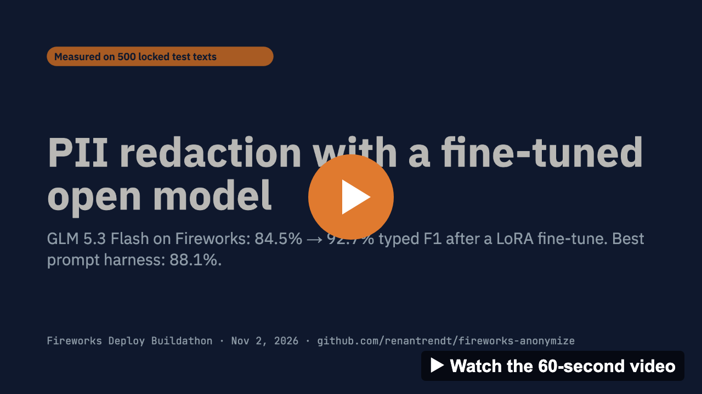
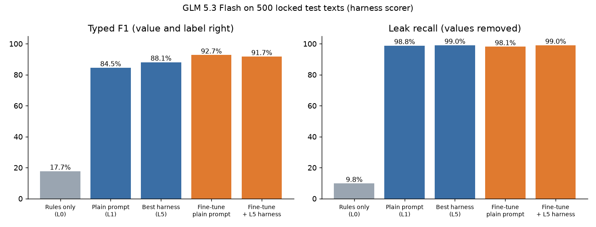
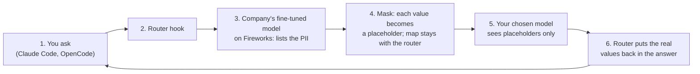
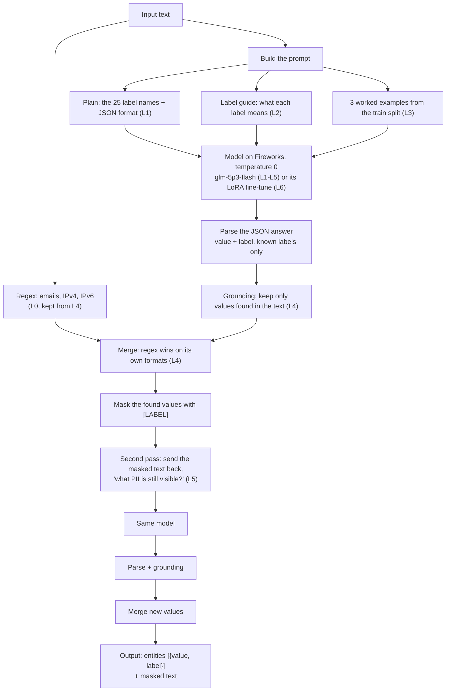
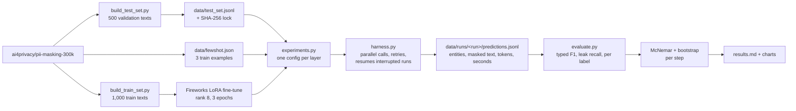
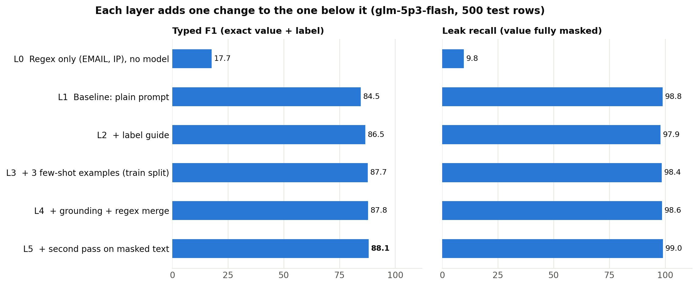
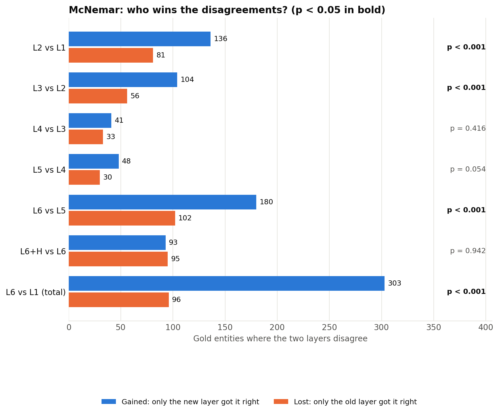
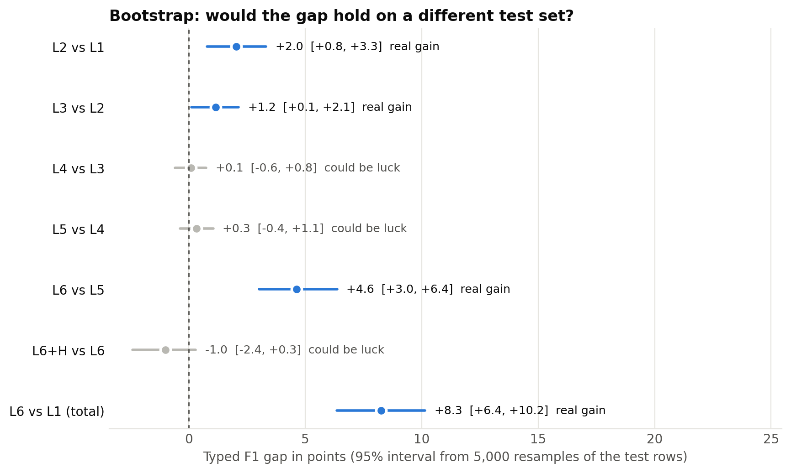
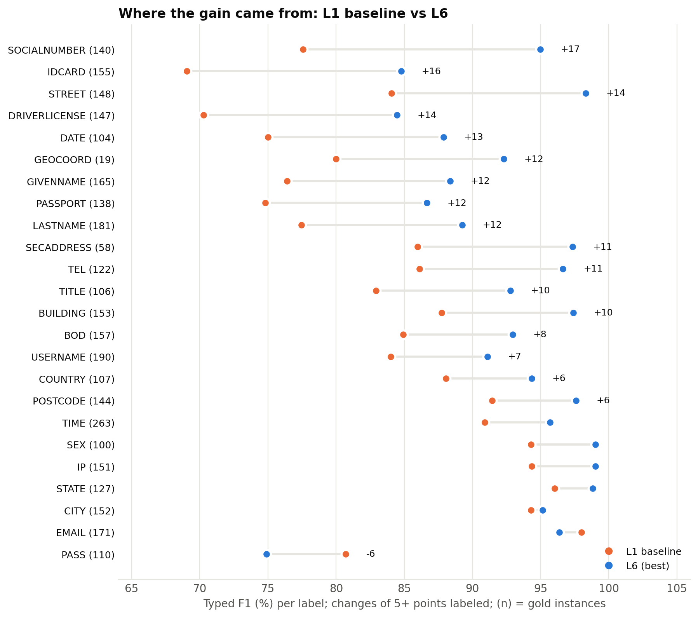
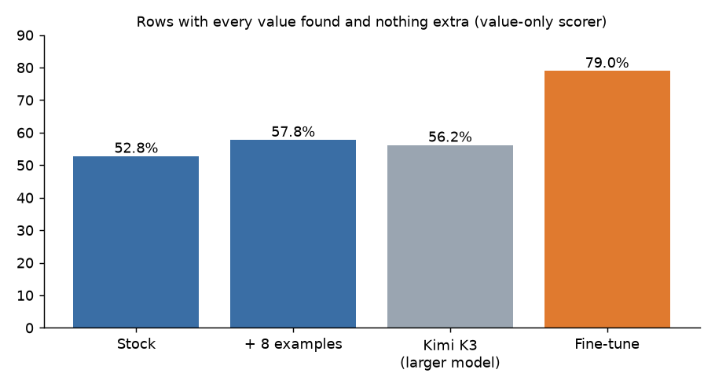

# PII redaction with a fine-tuned open model on Fireworks

[](docs/pii-redaction-60s.mp4)

We built a model that finds personal data (PII) in text, so it can be masked before the text is sent to an outside AI model. We picked a small open model, `glm-5p3-flash`, measured a plain prompt, improved it one layer at a time with a prompt harness, and then fine-tuned it with LoRA. Every step was scored on the same 500 locked test texts and checked with two statistical tests.

**Headline:** typed F1 goes from **84.5%** with a plain prompt to **88.1%** with the best prompt harness, and to **92.7%** with the LoRA fine-tune: +4.6 points over the best harness (McNemar p < 0.0001, bootstrap 95% range +3.0 to +6.4) and +8.3 over the plain prompt. Wrapped in the full harness, the fine-tuned model removes **99.0%** of personal values and leaves **94.8%** of texts with no leak.



Slides: [docs/deck.pdf](docs/deck.pdf) · 60-second video: [docs/pii-redaction-60s.mp4](docs/pii-redaction-60s.mp4)

**Disclosure.** The offline anonymizer in `scripts/anonymize.py` existed before the event; it was built for Brazilian legal documents and copied into this repo on the day from earlier private work. Everything else here was built on the day. We used AI coding assistants (Claude Code, Cursor) throughout.

## Contents

**Part 1: Submission**
1. [Problem statement](#1-problem-statement)
2. [Business value](#2-business-value)
3. [Technical execution](#3-technical-execution): base model, prompt harness L0-L5, L6 LoRA fine-tune
4. [Benchmark evaluation](#4-benchmark-evaluation): results, significance tests, where the gains came from
5. [Self-assessment against the rubric](#5-self-assessment-against-the-rubric)
6. [Limitations and disclosures](#6-limitations-and-disclosures)
7. [Next](#7-next)

**Part 2: Reproduce**

8. [Setup](#8-setup)
9. [Prompt harness and fine-tune runs](#9-prompt-harness-and-fine-tune-runs)
10. [Training the fine-tune and value-only scoring](#10-training-the-fine-tune-and-value-only-scoring)
11. [Router demo](#11-router-demo)
12. [Multi-provider evaluation](#12-multi-provider-evaluation)
13. [Tests](#13-tests)
14. [Where every number comes from](#14-where-every-number-comes-from)
15. [Data, license and sources](#15-data-license-and-sources)

---

# Part 1: Submission

## 1. Problem statement

Teams want to send support tickets, emails and legal files to an LLM without sending the personal data in them. That means finding every personal value, naming its type, and masking it before the text reaches an outside AI model.

- **Regex and rules** catch fixed formats such as email addresses, but not names, street addresses or free-form ID numbers. On our test set, rules alone find 9.8% of personal values.
- **A frontier API** finds them, but then the personal data has already reached a third party, which is what we were trying to prevent.

**The task:** find every personal value in a text, give it one of 25 labels, and replace it with that label. The model only returns values and labels; code does the masking, so the model never rewrites the text.

| Input | Output |
|---|---|
| Hi, I'm Dr Maria Ortega (born 12/03/1988). Reach me at maria.o@example.com or +44 20 7946 0958. | Hi, I'm [TITLE] [GIVENNAME] [LASTNAME] (born [BOD]). Reach me at [EMAIL] or [TEL]. |

The 25 labels are the dataset's own: names (GIVENNAME, LASTNAME, TITLE, SEX), dates (BOD, DATE, TIME), contact and login details (EMAIL, TEL, USERNAME, PASS, IP), ID numbers (IDCARD, PASSPORT, DRIVERLICENSE, SOCIALNUMBER, CARDISSUER) and address parts (BUILDING, STREET, SECADDRESS, CITY, STATE, POSTCODE, COUNTRY, GEOCOORD). The data is [ai4privacy/pii-masking-300k](https://huggingface.co/datasets/ai4privacy/pii-masking-300k): English, synthetic, labeled per value.

## 2. Business value

**Who needs it:** legal, security and compliance teams that route client text through AI models and must keep personal data out of them.

**How it runs:** a router in Claude Code or OpenCode sends the text first to the company's own fine-tuned model on Fireworks. The router replaces each value with a placeholder, sends only the masked text to the model the user chose, and puts the real values back in the answer.



`scripts/router_demo.py` runs this path on one email: the fine-tune found all 8 values, Kimi K3 drafted a reply seeing only placeholders, and the router restored the real values (`runs/router_demo.txt`). It is one example, not a measurement; the benchmark below measures step 3.

**Why a fine-tuned open model:**

- **More accurate.** The fine-tune scores 92.7% typed F1, against 88.1% for the best prompting we could build on the same model.
- **Faster and cheaper per text.** With a plain prompt the fine-tuned model answers in 1.7 seconds with 119 output tokens per text. The stock model with the best harness needs two calls, 3.8 seconds, and about 3,800 input and 520 output tokens.
- **The company owns the weights.** Personal data goes only to the company's own deployment; the user's chosen model sees placeholders.
- **It extends.** A new PII type is a short LoRA retrain on the same pipeline.

## 3. Technical execution

### Choosing the base model

We wanted a small, fast open model that Fireworks can fine-tune, so the fine-tune would be a same-model comparison. We tried four models with the same harness setup on 20 texts:

| Model | Typed F1 (20 texts) | Seconds per text | Notes |
|---|---|---|---|
| **glm-5p3-flash** | 86.5% | **2.8** | Fast and fine-tunable on Fireworks; chosen |
| gpt-oss-120b | 80.9% | 3.0 | Lowest score |
| qwen3p8-max, low reasoning | 87.7% | 4.0 | |
| qwen3p8-max, default reasoning | 91.3% | 15.4 | Five times slower; sometimes spent its whole token budget thinking and returned nothing |

On the full 500 texts with the same setup, `qwen3p8-max` scored 87.6% against 87.8% for `glm-5p3-flash`, at 12.0 seconds per text instead of 3.1, so the larger model did not help.

### The prompt harness, one layer at a time

`scripts/harness.py` wraps the model in layers, each turned on by a switch. Each layer keeps everything from the layer before it and adds one change, so the effect of each idea is measured on its own.



| Layer | What it adds | The failure it targets |
|---|---|---|
| L0 | Regex only (emails, IPs), no model | Reference point: what fixed patterns catch |
| L1 | Plain prompt: the 25 label names, JSON output | Baseline: is a model on its own enough? |
| L2 | + label guide | The model does not know that BOD is a birth date or that BUILDING is only the house number |
| L3 | + 3 worked examples from the train split | It needs to see names and addresses split into parts |
| L4 | + grounding and regex merge | Models invent or reformat values, and miss fixed formats a regex never misses |
| L5 | + second pass on the masked text | One look misses things |
| **L6** | **LoRA fine-tune of the same model** | The ID-number labels that prompting could not fix |

A longer write-up of the harness layers is in [docs/layered-harness.md](docs/layered-harness.md).

### L6: the LoRA fine-tune

- **Training data:** 1,000 English rows from the train split, with the dataset's own labels as the answers (`scripts/build_train_set.py`, `data/train_gold.jsonl`). The test set comes from the validation split, so no test text is in training.
- **Training:** Fireworks supervised fine-tuning, LoRA rank 8, 3 epochs, base `glm-5p3-flash`. The job took 17 minutes; its settings and timestamps are in `runs/finetune-job.json`.
- **Scoring:** the fine-tuned model replaces the stock one in the same harness and scorer: once with the plain L1 prompt (L6), once with the full L5 harness (L6+H).
- **Teacher set, not trained yet:** following the Fireworks "import" recipe (distill a teacher, keep only what a checker passes), Kimi K3 labeled the same 1,000 texts and we kept the 567 answers that matched the labels (`scripts/build_teacher_set.py`, `data/train_teacher.jsonl`). The fine-tune above was trained on the dataset's labels, not on Kimi's answers.

### How the experiments run



## 4. Benchmark evaluation

### Test set and scores

- **Test set:** 500 English texts from the validation split, with 3,309 personal values. 51 texts contain none, so over-redaction is measured too. Locked with a SHA-256 hash (`data/test_set.sha256`) before any model ran; every run checks it.
- **Typed F1 (headline):** a prediction counts only if the value is exact and the label is right.
- **Leak recall (privacy):** the share of personal values fully removed from the masked text, whatever label they got. A wrong label is harmless if the value is masked.
- **Texts with no leak:** texts where every personal value was removed.
- **Same conditions for every system:** the same 500 texts, temperature 0, one saved row per text. A failed API call is scored as an unmasked text.

### Results



| Layer | System | Typed F1 | Leak recall | Texts with no leak | Seconds per text |
|---|---|---|---|---|---|
| L0 | Regex only | 17.7% | 9.8% | 12.0% | 0.0 |
| L1 | Plain prompt, stock (baseline) | 84.5% | 98.8% | 94.0% | 4.0 |
| L2 | + label guide | 86.5% | 97.9% | 90.2% | 5.5 |
| L3 | + 3 worked examples | 87.7% | 98.4% | 91.6% | 2.8 |
| L4 | + grounding and regex | 87.8% | 98.6% | 92.8% | 3.1 |
| L5 | + second pass (best harness, stock) | 88.1% | **99.0%** | 94.2% | 3.8 |
| **L6** | **LoRA fine-tune, plain prompt** | **92.7%** | 98.1% | 90.0% | **1.7** |
| L6+H | LoRA fine-tune + full harness | 91.7% | **99.0%** | **94.8%** | 2.4 |

What each step did:

- **Label guide (+2.0)** fixed label confusion: precision rose from 81.7% to 84.1%.
- **Worked examples (+1.2)** taught how names and addresses split into parts, and made answers shorter, so each text took 2.8 seconds instead of 5.5.
- **Grounding and regex (+0.1)** changed almost nothing: the model was not inventing values, so this layer is a safety net.
- **Second pass (+0.3)** raised leak recall to 99.0%, at twice the calls per text.
- **The fine-tune (+4.6 over the best harness)** gave the largest gain of any step, with the shortest and fastest answers.
- **The harness on top of the fine-tune** lowered typed F1 by 1.0 point (could be luck) but left more texts fully clean: 94.8%, against 90.0% for the fine-tune alone. For redaction the leak matters more than the label, so the fine-tune inside the full harness (L6+H) is the version to ship.

### Is each step real?

Following the [Forge sample submission](https://app.notion.com/p/Forge-Deploy-Sample-Submission-4093715e8b9b80e3beefcd833c37fa90), each step gets two tests and counts as real only when both agree. **McNemar** looks only at the personal values where two systems disagree and asks whether the new one wins more of them than a coin flip would. The **bootstrap** resamples the 500 texts 5,000 times and gives a 95% range for the F1 gap.

| Comparison | Values gained | Values lost | McNemar p | F1 gap | 95% range | Verdict |
|---|---|---|---|---|---|---|
| L2 vs L1 (label guide) | 136 | 81 | 0.0002 | +2.0 | +0.8 to +3.3 | Real gain |
| L3 vs L2 (examples) | 104 | 56 | 0.0002 | +1.2 | +0.1 to +2.1 | Real gain |
| L4 vs L3 (grounding, regex) | 41 | 33 | 0.42 | +0.1 | -0.6 to +0.8 | Could be luck |
| L5 vs L4 (second pass) | 48 | 30 | 0.054 | +0.3 | -0.4 to +1.1 | Could be luck |
| **L6 vs L5 (fine-tune vs best harness)** | **180** | **102** | **< 0.0001** | **+4.6** | **+3.0 to +6.4** | **Real gain** |
| L6+H vs L5 (same harness, fine-tuned vs stock) | 145 | 69 | < 0.0001 | +3.6 | +2.4 to +4.9 | Real gain |
| L6+H vs L6 (harness on the fine-tune) | 93 | 95 | 0.94 | -1.0 | -2.4 to +0.3 | Could be luck |
| **L6 vs L1 (total)** | **303** | **96** | **< 0.0001** | **+8.3** | **+6.4 to +10.2** | **Real gain** |





### Where the gains came from



Prompting improved addresses, names and dates, but it made the ID-number labels slightly worse: after L5, social number, passport and driver's license sat at 68.5% to 71.9% F1. The fine-tune fixed exactly those. From L1 to L6: social number 77.6% to 95.0%, ID card 69.1% to 84.8%, driver's license 70.3% to 84.5%, passport 74.8% to 86.7%. One label got worse: passwords, 80.7% to 74.9%.

### A second scorer agrees

`scripts/score_fireworks.py` scores the same 500 texts with its own prompt (`scripts/pii_prompt.py`) and counts a text as fully correct when every value is found and nothing extra is listed, labels ignored:



| System | Texts fully correct | Values missed | Precision | Bad JSON | p50 time |
|---|---|---|---|---|---|
| glm-5p3-flash, stock | 52.8% | 10.8% | 0.886 | 9 | not measured |
| + 8 examples in the prompt | 57.8% | 8.1% | 0.908 | 4 | 4.0 s |
| + 16 examples in the prompt | 56.2% | 7.0% | 0.908 | 5 | 4.3 s |
| Kimi K3, stock (a much larger model) | 56.2% | 13.7% | 0.904 | 18 | 7.9 s |
| **LoRA fine-tune** | **79.0%** | **2.5%** | **0.961** | **0** | **0.9 s** |

| Comparison (texts fully correct) | Only before right | Only after right | McNemar p | Bootstrap 95% gain |
|---|---|---|---|---|
| Fine-tune vs stock | 29 | 160 | < 0.0001 | +21.4 to +31.0 points |
| Fine-tune vs 8-example prompt | 30 | 136 | < 0.0001 | +16.6 to +25.8 points |

A second scoring run of the same fine-tune gave 77.8%; the gap is run-to-run noise. More examples in the prompt and a much larger stock model both stay far below the fine-tune.

### Cost and time

| Step | Time | Cost |
|---|---|---|
| Train (LoRA, 1,000 rows, 3 epochs) | 17 min (job timestamps) | $11.12, Fireworks job estimate in `runs/finetune-job.json`; not checked against the invoice |
| Test (all 500 texts, 8 in parallel) | about 3 min | not computed in dollars |
| Inference, one text | 1.7 s mean (L6); 0.9 s p50 on the value-only run | 256k input and 119k output tokens per 1,000 texts (L1 stock: 256k and 555k) |

## 5. Limitations and disclosures

- **Synthetic data.** The texts are generated, in English only and under 512 characters. Real legal files are longer and messier.
- **The model choice touched the test set.** The base model and its reasoning setting were picked from a 20-text probe on test rows rather than a separate dev set. No prompt was tuned on the test set afterwards; examples and training data come from the train split.
- **One training run.** No hyperparameter sweep and one seed.
- **Exact-match scoring is strict.** A value with one extra character counts as a miss for typed F1, even when leak recall shows it was masked.
- **CARDISSUER has one example** in the test set, so its score is not used for conclusions. Numbered name labels (LASTNAME1/2/3) are merged into one.
- **Seconds per text** in the results table are the mean of the final call per text. Averaging every call, including retries after rate limits, gives 2.4 and 3.0 seconds for the two fine-tuned rows.
- **Cost is in tokens, not dollars.** `data/experiments/glm-5p3-flash/results.md` lists input and output tokens per text for each layer.
- **Fireworks receives the raw text.** Only the company's own deployment sees personal data; the user's chosen model sees placeholders. The router is a script, not yet a Claude Code hook.

## 6. Next

1. Train on the teacher-filtered set, then RL with the same scorer as the reward (import, then consolidate).
2. A frontier comparison (GPT and Claude) on the same 500 texts, with cost per 1,000 texts.
3. Portuguese legal documents, the use case the offline anonymizer was built for.

---

# Part 2: Reproduce

## 8. Setup

Requires Python 3.9 or later and a Fireworks API key.

```bash
pip install -r scripts/requirements.txt
export FIREWORKS_API_KEY=...            # never commit it
```

The test set is already in `data/` and locked by its hash. `scripts/build_test_set.py` rebuilds it from Hugging Face but overwrites `data/test_set.*`, so run it only to check the files, and expect `git diff data/` to be empty afterwards.

## 9. Prompt harness and fine-tune runs

```bash
# Every layer (L0-L5) on the 500 test texts, then the report and statistics.
# Runs resume where they stopped; failed rows are retried on the next run.
python scripts/experiments.py --model glm-5p3-flash

# The fine-tuned model through the same harness: plain prompt (L6) and full L5 harness (L6+H).
M=accounts/<account>/models/<fine-tuned model>
python scripts/harness.py --run lora-L1 --model $M --prompt plain --shots 0 --no-ground --no-regex --workers 2
python scripts/harness.py --run lora-L5 --model $M --prompt guide --shots 3 --passes 2 --workers 2

# Report with the fine-tune as L6, including fine-tuned vs stock under the same harness, then the charts.
python scripts/experiments.py --model glm-5p3-flash --report-only \
  --extra "L6=lora-L1=LoRA fine-tune, plain prompt" \
  --extra "L6+H=lora-L5=LoRA fine-tune + harness (L2-L5)=L5"
python scripts/charts.py --prefix glm-5p3-flash

# Try the best stock layer on any text:
python scripts/harness.py --model glm-5p3-flash --passes 2 \
  --text "Call Jane Doe at +44 20 7946 0958 or jane@acme.com"
```

Keep `--workers` low for a fine-tuned model: parallel runs hit Fireworks rate limits (HTTP 429).

## 10. Training the fine-tune and value-only scoring

```bash
python3 scripts/build_train_set.py                 # data/train_gold.jsonl (1,000 rows)
python3 scripts/build_teacher_set.py accounts/fireworks/models/kimi-k3   # data/train_teacher.jsonl
```

Upload `data/train_gold.jsonl` as a Fireworks dataset and start a LoRA job on `glm-5p3-flash` (rank 8, 3 epochs); the settings we used are in `runs/finetune-job.json`. Then deploy it (serverless LoRA must be enabled on the account) and score it:

```bash
python3 scripts/score_fireworks.py <model> runs/<name>.jsonl [--fewshot 8]
python3 scripts/compare_runs.py runs/base-glm-5p3-flash.jsonl runs/lora-gold.jsonl   # McNemar + bootstrap
```

The prompt for this scorer is `scripts/pii_prompt.py`.

## 11. Router demo

```bash
python3 scripts/router_demo.py "Draft a short reply to this client email: Hi, I'm Maria Oliveira (passport FX482913). Please send the signed contract to maria.oliveira@acme-law.com or call me at +1 415 555 0142."
```

Set `USER_MODEL` to choose the outside model (default Kimi K3).

## 12. Multi-provider evaluation

`scripts/eval_models.py` scores models from Fireworks (`FIREWORKS_API_KEY`), OpenAI (`OPENAI_API_KEY`) and Anthropic (`ANTHROPIC_API_KEY`) on the same test set.

```bash
python3 scripts/eval_models.py --list-models        # what your keys can call
python3 scripts/eval_models.py --limit 20           # smoke run
python3 scripts/eval_models.py --by-label           # full run, per-label detail
python3 scripts/eval_models.py --concurrency 16 \
    --models "accounts/fireworks/models/glm-5p3-flash,openai:gpt-5-mini,anthropic:claude-haiku-4-5"
```

Model ids route by name (`gpt-*`/`o1`/`o3`/`o4` → OpenAI, `claude-*` → Anthropic, anything else → Fireworks); an explicit `openai:` / `anthropic:` / `fireworks:` prefix overrides that. Two scores per model: **strict** (value and label must match) and **value-only**. Raw predictions land in `results/preds-*.jsonl`; summaries in `results/eval-*.json`.

## 13. Tests

```bash
python3 -m pytest tests/test_eval_models.py -q
```

The tests stub the model APIs, so they run without API keys.

## 14. Where every number comes from

| Number | File |
|---|---|
| Test set and its lock | `data/test_set.jsonl`, `data/test_set.sha256` |
| Base model probe (20 texts) | `data/runs/probe-glm-flash/`, `data/runs/probe-gpt-oss/`, `data/runs/harness-qwen3p8-max-low/`; default-reasoning qwen3p8-max is the first 20 rows of `data/runs/harness-qwen3p8-max/` |
| Harness layers L0-L5 | `data/runs/glm-5p3-flash-L*/` (`predictions.jsonl`, `report.json`) |
| Fine-tune through the harness (L6, L6+H) | `data/runs/lora-L1/`, `data/runs/lora-L5/` |
| Harness statistics and charts, including L6 | `data/experiments/glm-5p3-flash/` (`results.md`, `results.json`, `charts/`) |
| Value-only scorer runs | `runs/base-glm-5p3-flash.jsonl`, `runs/fewshot8-glm-5p3-flash.jsonl`, `runs/fewshot16-glm-5p3-flash.jsonl`, `runs/kimi-k3.jsonl`, `runs/lora-gold.jsonl`, `runs/lora-pii-gold-glm53.jsonl` (+ `*.summary.json`) |
| Training data and job | `data/train_gold.jsonl`, `data/train_teacher.jsonl`, `runs/finetune-job.json` |
| Headline charts | `data/experiments/finetune/` |
| Router demo output | `runs/router_demo.txt` |

Every per-row file keeps the model's raw output, so any score can be recomputed without calling an API.

## 15. Data, license and sources

- Data: [ai4privacy/pii-masking-300k](https://huggingface.co/datasets/ai4privacy/pii-masking-300k), used under the dataset's license, with credit to AI4Privacy.
- Fireworks cookbook and the "import → consolidate" livestream recipe.
- Fireworks: Deploy sample submission (format and rubric weights).
- The offline document anonymizer that this repo started from is documented in `docs/offline-anonymizer.md`.
