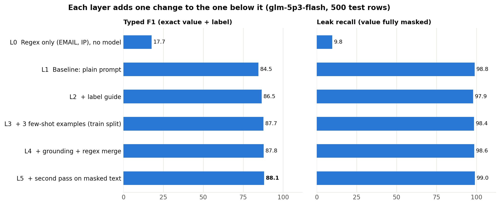
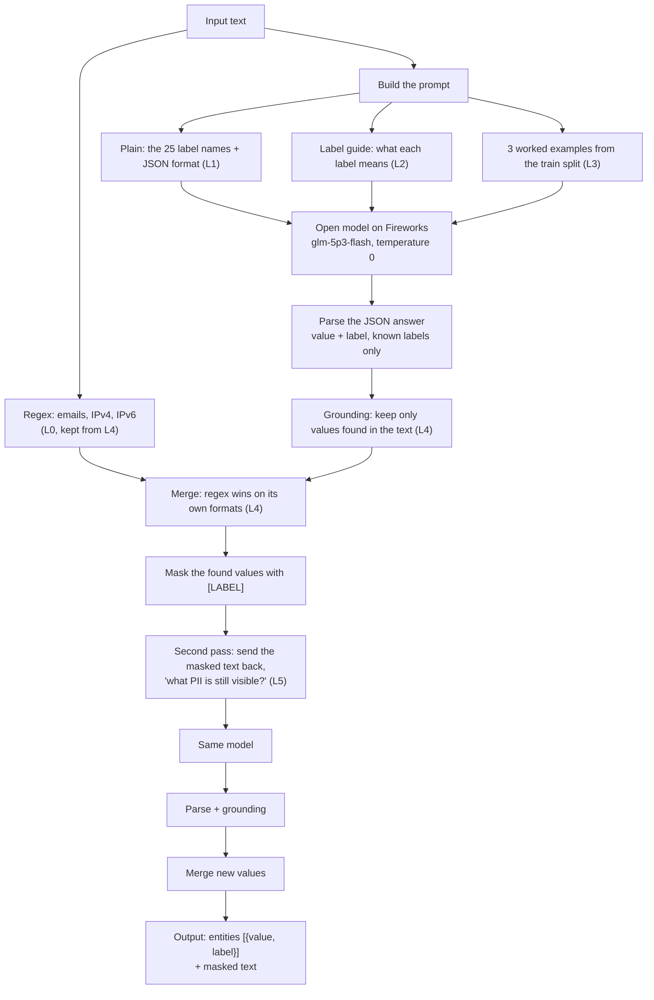
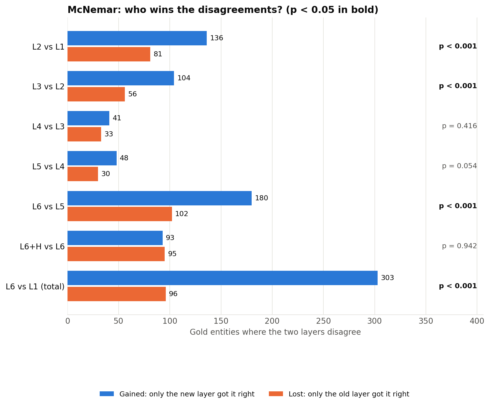
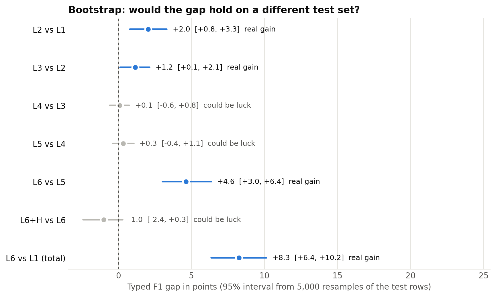
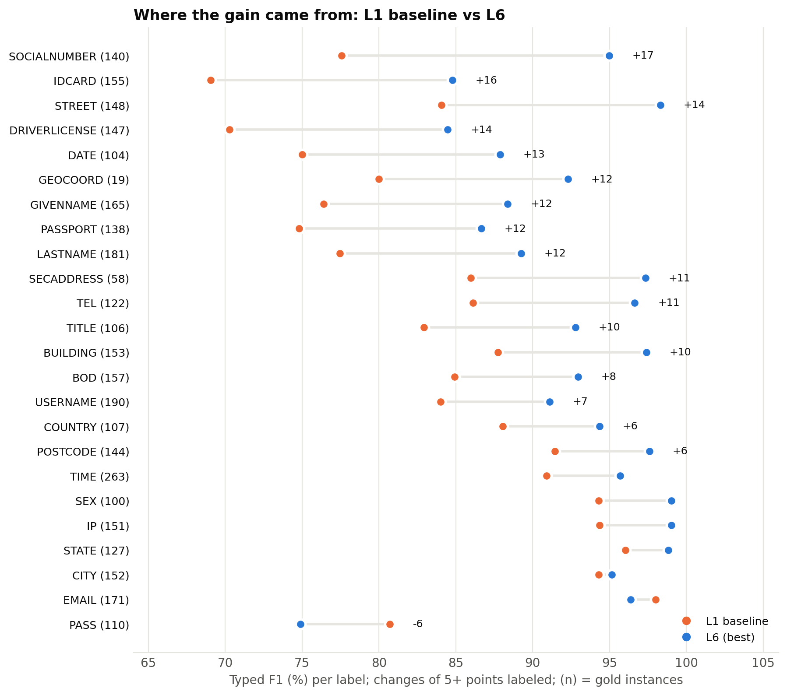

# PII redaction with open models

Find personal data (PII) in text, label it, and mask it before the text goes to an LLM, using a small open model on Fireworks instead of a frontier API.

**Result:** a plain prompt on `glm-5p3-flash` already removes 98.8% of PII values. Two prompt changes and a second pass raise typed F1 from **84.5% to 88.1%** (+3.6 points, confirmed by McNemar and a bootstrap interval), with **99.0%** of PII values removed, at about 4 seconds per text. All numbers are on a locked test set of 500 texts.



## The problem

Teams want to send support tickets, emails and legal files to an LLM without sending the personal data in them. That means finding every piece of PII, naming its type, and masking it before the text leaves the company.

- **Regex** catches fixed formats such as email addresses, but not names, street addresses or free-form ID numbers.
- **A frontier API** finds them, but then the PII has already left the company, which is what we were trying to prevent.

An open model can run where the data already is: on a managed deployment or inside the customer's own cloud.

## The task

Find every PII value in a text, give it one of 25 labels, and replace it with that label. The model only returns the values and labels; the masking is done by code, so the model never rewrites the text.

| Input | Output |
|---|---|
| Hi, I'm Dr Maria Ortega (born 12/03/1988). Reach me at maria.o@example.com or +44 20 7946 0958. | Hi, I'm [TITLE] [GIVENNAME] [LASTNAME] (born [BOD]). Reach me at [EMAIL] or [TEL]. |

The 25 labels are the dataset's own: names (GIVENNAME, LASTNAME, TITLE, SEX), dates (BOD, DATE, TIME), contact details (EMAIL, TEL, USERNAME, PASS, IP), ID numbers (IDCARD, PASSPORT, DRIVERLICENSE, SOCIALNUMBER, CARDISSUER) and address parts (BUILDING, STREET, SECADDRESS, CITY, STATE, POSTCODE, COUNTRY, GEOCOORD).

## Architecture

### How one text is masked (`scripts/harness.py`)

Each box is tagged with the layer that turns it on. The model only lists values and labels; code does the masking, so the original text is never rewritten by the model.



### How the experiments are run and scored

```mermaid
flowchart LR
    HF["ai4privacy/pii-masking-300k<br/>validation split, English"] --> BT["build_test_set.py<br/>500 texts, 3,309 PII values"]
    BT --> TS["data/test_set.jsonl<br/>+ SHA-256 lock"]
    TR["train split"] --> FS["data/fewshot.json<br/>3 worked examples"]
    TS --> EXP["experiments.py<br/>one config per layer L0-L5"]
    FS --> EXP
    EXP --> H["harness.py<br/>8 texts in parallel, retries,<br/>resumes interrupted runs"]
    H --> PRED["data/runs/&lt;layer&gt;/predictions.jsonl<br/>entities, masked text, tokens, seconds"]
    PRED --> EV["evaluate.py<br/>typed F1, leak recall,<br/>per-label scores"]
    EV --> ST["experiments.py<br/>McNemar per PII value<br/>bootstrap, 5,000 resamples"]
    ST --> RES["results.md / results.json"]
    RES --> CH["charts.py<br/>4 charts"]
```



## How we measured

- **Test set:** 500 English texts from the validation split of [ai4privacy/pii-masking-300k](https://huggingface.co/datasets/ai4privacy/pii-masking-300k), with 3,309 PII values. 51 texts contain no PII, so over-redaction is measured too. The file is locked by its SHA-256 (`data/test_set.sha256`), and every run checks the hash before it starts.
- **Typed F1:** a prediction counts only if the value is exact and the label is right. This is the headline score.
- **Leak recall:** the share of PII values fully removed from the masked text, whatever label they got. This is the privacy score: a wrong label is harmless if the value is masked.
- **Failed calls count against the system.** If an API call fails, the text is scored as unmasked.
- **Same model, temperature 0, one change per layer.** Each layer is a full run over the same 500 texts.

## Results, one layer at a time

Each layer keeps everything from the layer before it and adds one change.

| Layer | Change | Typed F1 | Leak recall | F1 change | Seconds per text |
|---|---|---|---|---|---|
| L0 | Regex only (EMAIL, IP), no model | 17.7% | 9.8% | | 0.0 |
| **L1** | **Plain prompt: the 25 label names, JSON output (baseline)** | **84.5%** | **98.8%** | | 4.0 |
| L2 | + label guide | 86.5% | 97.9% | +2.0 | 5.5 |
| L3 | + 3 worked examples from the train split | 87.7% | 98.4% | +1.2 | 2.8 |
| L4 | + grounding and regex merge | 87.8% | 98.6% | +0.1 | 3.1 |
| **L5** | **+ second pass on the masked text** | **88.1%** | **99.0%** | +0.3 | 3.8 |

What each step did:

- **Rules alone (L0)** find 9.8% of PII values. What they find is right 98.2% of the time, but names, addresses, dates and ID numbers have no fixed format.
- **Plain prompt (L1)** already removes almost all PII. Its errors are mostly a wrong label or a slightly wrong boundary, concentrated in ID numbers, dates and first names. It also redacted something in 9 of the 51 texts with no PII.
- **Label guide (L2, +2.0):** one line per label saying what it means in this dataset, for example BOD is a birth date and BUILDING is only the house number. Precision rose from 81.7% to 84.1%, while leak recall dipped to 97.9%: the gain came from better labels, not from finding more.
- **Worked examples (L3, +1.2):** three examples from the train split show how names and addresses split into parts. Answers also got shorter (414 output tokens instead of 786), so each text took 2.8 seconds instead of 5.5.
- **Grounding and regex (L4, +0.1):** dropping values not found in the text and adding regex emails and IPs changed almost nothing. The model was not inventing values, so this layer is a safety net rather than a gain.
- **Second pass (L5, +0.3):** sending the masked text back with "what PII is still visible?" raised leak recall to 99.0% and texts with no leak to 94.2%, at twice the calls per text.

## Is each gain real?

Following the [Forge sample submission](https://app.notion.com/p/Forge-Deploy-Sample-Submission-4093715e8b9b80e3beefcd833c37fa90), each step gets two tests and counts as real only when both agree:

- **McNemar** looks only at the PII values where two layers disagree, and asks whether the new layer wins more of them than a coin flip would.
- **Bootstrap** resamples the 500 texts 5,000 times and gives a 95% interval for the F1 gap.

| Comparison | Values gained | Values lost | McNemar p | F1 gap | 95% interval | Verdict |
|---|---|---|---|---|---|---|
| L2 vs L1 | 136 | 81 | 0.0002 | +2.0 | +0.8 to +3.3 | Real gain |
| L3 vs L2 | 104 | 56 | 0.0002 | +1.2 | +0.1 to +2.1 | Real gain |
| L4 vs L3 | 41 | 33 | 0.42 | +0.1 | -0.6 to +0.8 | Could be luck |
| L5 vs L4 | 48 | 30 | 0.054 | +0.3 | -0.4 to +1.1 | Could be luck |
| **L5 vs L1 (total)** | **177** | **48** | **<0.0001** | **+3.6** | **+2.3 to +4.9** | **Real gain** |





## Where the gain came from



Addresses, names and dates gained most from L1 to L5: geographic coordinates +17.4, secondary address +11.5, date +11.2, street +10.5, building number +8.4, title +8.2, last name +7.9, ID card +7.2. Three number-like labels got worse: social number -5.7, passport -3.0 and driver's license -1.8. They are now the weakest labels, at 68.5% to 71.9%, which is what a fine-tune should target next.

## Does a bigger model help?

Not on this task. With the L4 setup, `qwen3p8-max` (a larger reasoning model) scored 87.6% typed F1 and 97.5% leak recall, against 87.8% and 98.6% for `glm-5p3-flash`, and took 12.0 seconds per text instead of 3.1. Adding its predictions to L5 found 13 more values but added enough false positives that F1 did not improve, at about three times the time per text, so it is not part of the results above.

## Reproduce

Requires Python 3.9 or later and a Fireworks API key.

```bash
pip install -r scripts/requirements.txt
export FIREWORKS_API_KEY=...            # never commit it

# 1. The test set is already in data/ and locked by its hash; you do not need to rebuild it.
#    scripts/build_test_set.py rebuilds it from Hugging Face but OVERWRITES data/test_set.*,
#    so only run it to check the files, and expect `git diff data/` to be empty afterwards.

# 2. Run every layer (L0-L5) on the 500 test texts, then the report and statistics.
#    Runs resume where they stopped, and failed rows are retried on the next run.
python scripts/experiments.py --model glm-5p3-flash

# 3. Charts for this page.
python scripts/charts.py --prefix glm-5p3-flash

# Try the best layer (L5) on any text:
python scripts/harness.py --model glm-5p3-flash --passes 2 \
  --text "Call Jane Doe at +44 20 7946 0958 or jane@acme.com"

# Same setup on another model, for comparison:
python scripts/harness.py --run qwen-L4 --model qwen3p8-max
```

Each layer is one or two API calls per text, with 8 requests in parallel; the whole ladder took us well under an hour.

## Code

| File | What it does |
|---|---|
| `scripts/build_test_set.py` | Builds the 500-text test set from the validation split and writes its SHA-256 |
| `scripts/harness.py` | The system. One switch per layer: `--prompt plain\|guide`, `--shots`, `--no-ground`, `--no-regex`, `--passes`, `--model`. Calls Fireworks at temperature 0, parses the JSON, retries rate limits and empty answers, and saves one line per text with entities, masked text, tokens and latency |
| `scripts/evaluate.py` | The scorer: typed precision, recall and F1, leak recall, texts with no leak, per-label scores |
| `scripts/experiments.py` | Runs the layers on one model and writes `results.md` with the McNemar and bootstrap results |
| `scripts/charts.py` | The four charts on this page |
| `data/test_set.jsonl` | The locked test set: `{"id", "source_text", "entities": [{"value", "label"}]}` |
| `data/fewshot.json` | The three worked examples, from the train split |
| `data/runs/<run>/` | One line per test text (`predictions.jsonl`) and the scored `report.json` for each run |
| `data/experiments/glm-5p3-flash/` | `results.md`, `results.json` and the charts |

## Limitations and disclosures

- **Synthetic data.** The texts are generated; real tickets and emails are messier. English only, and texts are at most 512 characters, so long documents are not tested.
- **One model choice was made on test rows.** The ladder model (`glm-5p3-flash`) and its reasoning setting were picked from a 20-text probe on the test set rather than a separate dev set. The prompt and examples were not tuned on the test set; the examples come from the train split.
- **Exact-match scoring is strict.** A value with one extra character counts as a miss for typed F1, even when leak recall shows it was masked.
- **CARDISSUER has one example** in the test set (the English validation split has only one), so its score is not used for conclusions.
- **Numbered labels are merged.** LASTNAME1/2/3 become LASTNAME and GIVENNAME1/2 become GIVENNAME, because the numbering is an artifact of how the data was generated.
- **One test set, one run per layer.** Temperature 0 makes runs repeatable, but we did not test other seeds or other samples of the data.
- **Cost is reported in tokens, not dollars.** `results.md` has input and output tokens per text for each layer.
- **Fine-tuning and a frontier comparison are next.** A LoRA fine-tune of `glm-5p3-flash` on the train split (L7) was then run: through this same harness and scorer it reaches 92.7% typed F1 with the plain prompt (`data/runs/lora-L1/`, `data/runs/lora-L5/`; see SUBMISSION.md, Step 5).

## The rest of this repository

The repository's main [README](../README.md) covers the LoRA fine-tune results and the multi-provider model evaluation (`scripts/eval_models.py`). Those use their own prompt and scoring (rows fully correct, values missed), so their numbers are not directly comparable with the typed F1 here.

## Data and license

Data: [ai4privacy/pii-masking-300k](https://huggingface.co/datasets/ai4privacy/pii-masking-300k), used under the dataset's license, with credit to AI4Privacy.
